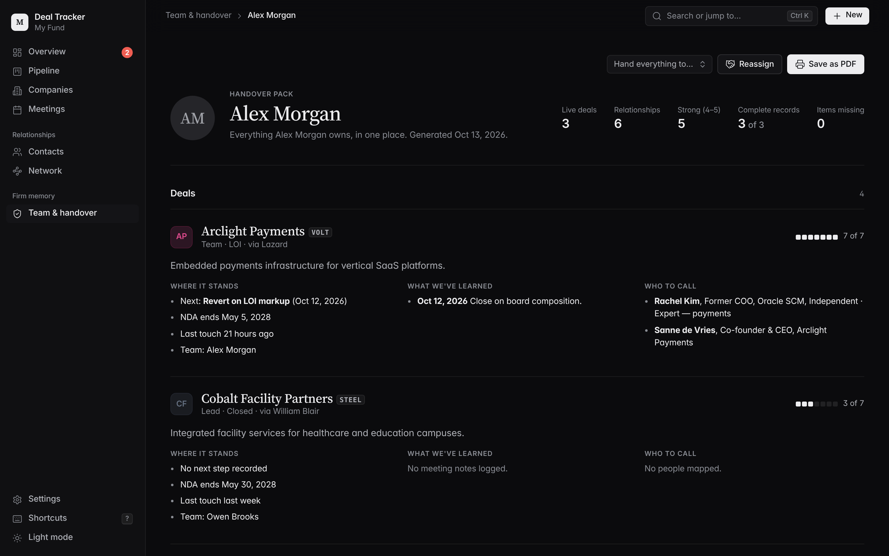
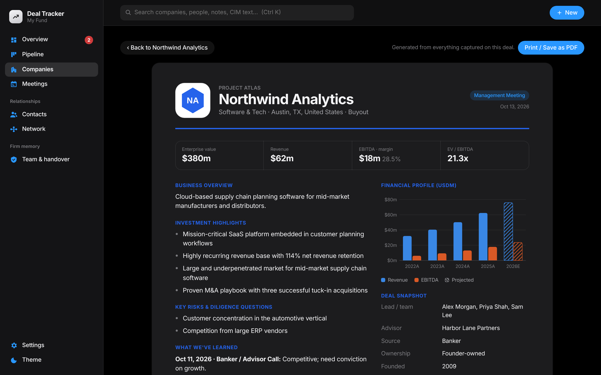

# Deal Tracker

A private, local deal-tracking app for private equity that keeps your firm's deal memory when people move on. It runs on your own computer. Your data, CIMs and models stay in a local folder unless you choose to use the optional Claude analysis.


## What it does

| Area | What you get |
|---|---|
| **Dashboard** | Live deals, pipeline EV, EBITDA and blended multiple, deals by stage, sector and region, 12-month activity, next steps (overdue ones flagged), upcoming meetings, a recent-activity feed and brand-coloured company cards. |
| **Companies** | Add a company in seconds with a logo, brand colour (it can pick the colour from the logo), sector, geography, stage, priority, deal type, EV, revenue, EBITDA, advisor and next step. Switch between card and table views, filter, sort and export to CSV. |
| **Pipeline** | A Kanban board. Drag a deal to another stage. Each move is time-stamped, and every company shows its stage history and days in stage. |
| **CIM fact detection** | Drop in a CIM (PDF, DOCX or TXT). The app detects revenue and EBITDA (from text and from financial tables), margins, CAGR, recurring revenue, retention, customers and concentration, headcount, HQ, founding year, CEO, ownership, sell-side advisor, transaction type, bid deadline, website, sector, geographies, investment highlights and risks. **Each fact shows the source sentence, page number and a confidence score.** You tick the facts to keep. You can also create a new company straight from a CIM. |
| **Claude analysis (optional)** | Add an Anthropic API key and click **Analyze with Claude** to have Claude read the whole document, including scanned PDFs. It adds facts with quotes, plus highlights, diligence questions and a summary. |
| **Models** | Upload LBO or operating models. Every upload becomes a new version (v1, v2…) with a timestamp. IRR, MOIC, entry and exit multiples, entry and exit EV, leverage, equity and hold period are read from the workbook and compared with the previous version. |
| **Meetings & market notes** | Log management presentations, banker calls, expert calls, site visits, IC meetings and general market meetings that aren't tied to a company. Each meeting has attendees, notes, takeaways, next steps and sentiment. All of it is searchable. |
| **Contacts & network diagram** | Track bankers, management, experts, co-investors and lenders, with relationship strength and meeting history. Map relationships such as "former colleague", "reports to" or "introduced". An interactive network diagram (drag, zoom, hover to trace connections) shows who connects to which deal. |
| **Everything else** | Global search (Ctrl/⌘ K) across companies, people, meeting notes and CIM text. A timeline for each company. Light and dark mode. Settings for stages, sectors, deal types and meeting types. JSON backup. |

| Company page | CIM fact review |
|---|---|
|  |  |
| **Pipeline** | **Relationship network** |
|  |  |
| **Handover pack** | **IC one-pager** |
|  |  |

### Firm memory: built for the day someone leaves
Firms lose deal context when senior people leave, and pass reasons, relationships and model history are rarely written down ([see the pitch](docs/PITCH.md)). Deal Tracker builds in:

| Feature | What it does |
|---|---|
| **Knowledge score** | Each live deal is checked for a lead, description, CIM facts, model, meeting notes, mapped people, and a next step or pass reason. Firm-wide and per-person scores appear on the dashboard and the Team page. |
| **Pass record** | Moving a deal to *Passed* asks for the reason, what would change your mind and a revisit date. These appear on the company page and on the one-pager. |
| **Prior-look warning** | Adding a company or reading a CIM checks names and codenames against past looks and shows who led it and why it was passed. |
| **Needs attention** | NDA confidentiality ending or expired, overdue next steps, revisit dates, live deals with no lead, stale deals and strong relationships going cold. |
| **Team & handover** | Each person gets a handover pack (deals, gaps to close, lessons learned, who to call, relationships to transfer). It prints to PDF, and one click reassigns everything to a successor. |
| **IC one-pager** | A printable tear sheet built from everything captured on a deal. |
| **Intermediaries** | Which advisors bring you deals, and how far those deals get. |

## Run it

You need **Python 3.9 or newer** ([python.org](https://www.python.org/downloads/)). On Windows, tick **Add python.exe to PATH** in the installer.

**1. Get the code.** Either clone it:

```bash
git clone https://github.com/GajusVi/Deal-Tracker.git
cd Deal-Tracker
```

or, on GitHub, click **Code → Download ZIP** and unzip it somewhere you'll keep it. The app stores your data inside this folder.

**2. Start it.**

- **macOS:** double-click `Start Deal Tracker.command`, or run `./run.sh` in Terminal.
  - If macOS says the file is from an *unidentified developer*, right-click it, choose **Open**, then **Open** again. You only need to do this once.
  - If you downloaded the ZIP and nothing happens, the launchers may have lost permission to run. Open Terminal in the folder and run `chmod +x run.sh "Start Deal Tracker.command"`.
- **Windows:** double-click `run.bat`. If you see *Python was not found*, reinstall Python with **Add python.exe to PATH** ticked.
- **Linux:** `./run.sh`

**3. Use it.** The first launch installs dependencies into a local `.venv` folder, which takes about a minute. After that the app starts in a second or two and opens **http://127.0.0.1:5050** in your browser. Keep the terminal window open while you use the app, and close it to stop the app. On the empty dashboard, click **Explore with sample data** to look around a sample pipeline. When you're ready to use it for real, click **Clear sample data** on the dashboard banner (or in **Settings**). Only the sample records are removed, and anything you've added yourself is kept. The app also offers to clear them when you add your first own company.

Options: `./run.sh --port 8080`, `./run.sh --data /path/to/folder`, `./run.sh --no-browser`.

### Updating
Close Deal Tracker, then run the updater in your Deal Tracker folder:

- **macOS:** double-click `Update Deal Tracker.command`
- **Windows:** double-click `update.bat`
- **Linux:** `./update.sh`

It downloads the latest version from GitHub and replaces the app files. Your `data` folder and any files of your own in the folder are kept. A git clone is updated with `git pull` instead.

It also cleans up older copies. It looks in Downloads, Desktop, Documents and next to the current folder for other Deal Tracker folders. It moves the most recently used data into this copy and deletes the old folders, after listing them and asking you once. Data it doesn't keep is saved to `data-backups/` first, and folders that are git clones are never deleted.

**Coming from a version without the updater?** Download the latest ZIP, unzip it, and double-click the updater inside the new folder. It finds your old copy, brings your data across and removes the old folder.

Options: `--cleanup-only` (tidy old copies without downloading), `--from-zip PATH` (update from a ZIP you already downloaded), `--yes` (don't ask).

### Try the CIM detection
`samples/` contains two sample CIMs (`Project_Cedar_CIM.pdf`, `Project_Atlas_CIM.txt`) and two versions of a sample LBO model. Use **New → Company from CIM** and drop in the PDF.

## Your data

Everything lives in the `data/` folder next to the app:
- `dealtracker.db` is a SQLite database with companies, meetings, contacts, settings and history.
- `uploads/` holds logos, CIMs, models and other documents.

To back up, copy that folder. **Settings → Download JSON backup** also exports everything except the files. The app only listens on `127.0.0.1`, so other computers on your network can't reach it. If you use `--host 0.0.0.0`, anyone on your network can open it, because there is no login.

### Claude (optional)
Set the `ANTHROPIC_API_KEY` environment variable, or paste a key in **Settings**. A key saved in Settings is stored in the local database. A document is sent to the Anthropic API only when you click **Analyze with Claude**. The rule-based detector works fully offline.

## Development

```bash
python3 -m venv .venv && .venv/bin/pip install -r requirements.txt pytest
.venv/bin/python -m pytest        # API, extractor and model-parser tests
.venv/bin/python run.py           # start the server
```

Stack: Flask + SQLite backend (`dealtracker/`). The frontend is plain HTML/CSS/ES modules with no build step (`static/`). Charts and the network diagram are hand-written SVG, so the app needs no CDN and works offline.

```
dealtracker/
  app.py            JSON API + static file serving
  db.py             schema, settings, activity log
  extractor.py      CIM text extraction + rule-based fact detection
  ai.py             optional Claude analysis (structured output)
  models_parser.py  reads IRR / MOIC / multiples from Excel models
  geo.py            country → region mapping
  seed.py           demo data
update.py           updater: latest version from GitHub + cleanup of old copies
static/js/
  app.js            router, global search, quick-add
  forms.js          company / contact / meeting dialogs, CIM review
  graph.js          force-directed relationship diagram
  charts.js         bar & column charts
  views/*.js        dashboard, pipeline, companies, company, meetings, contacts, settings
```
