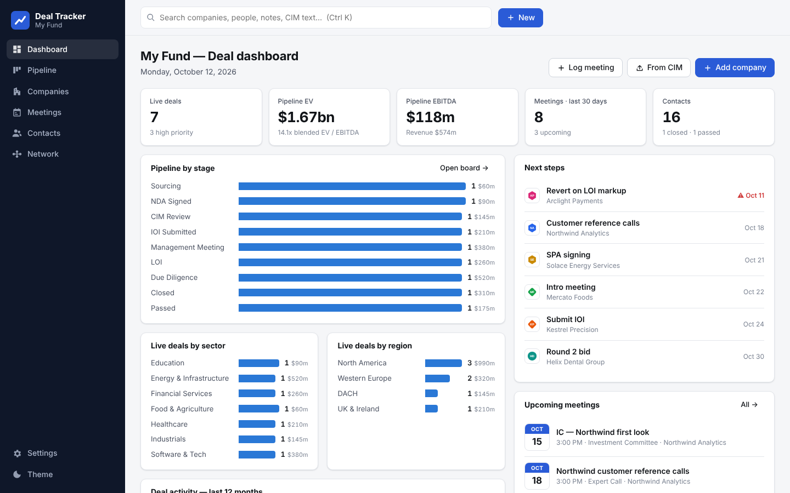
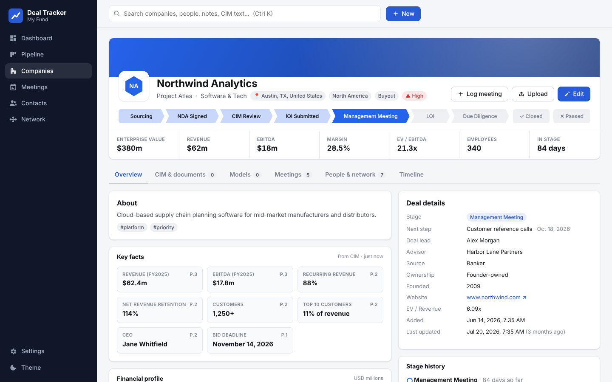
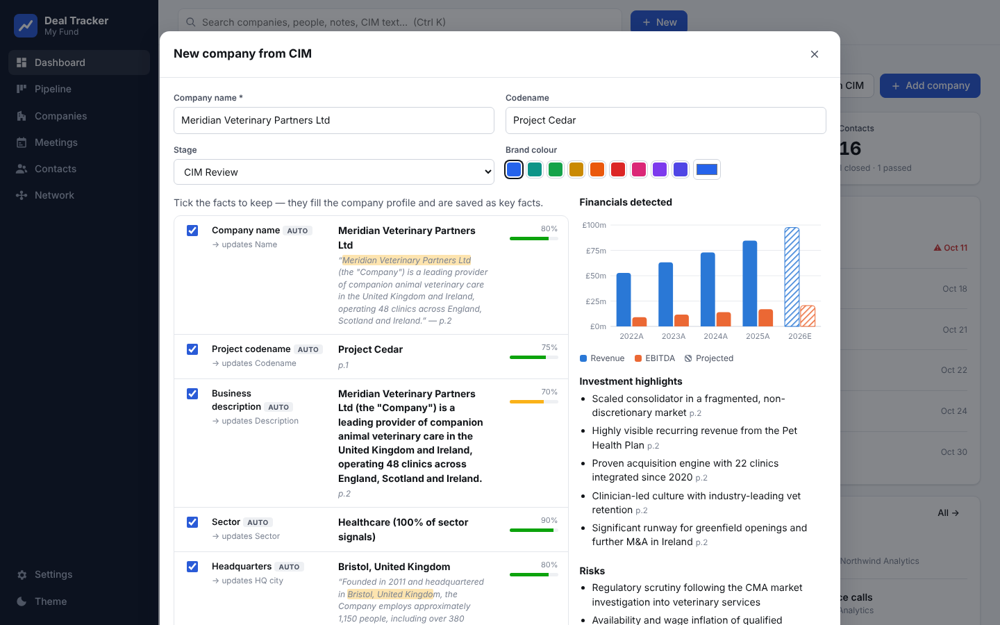
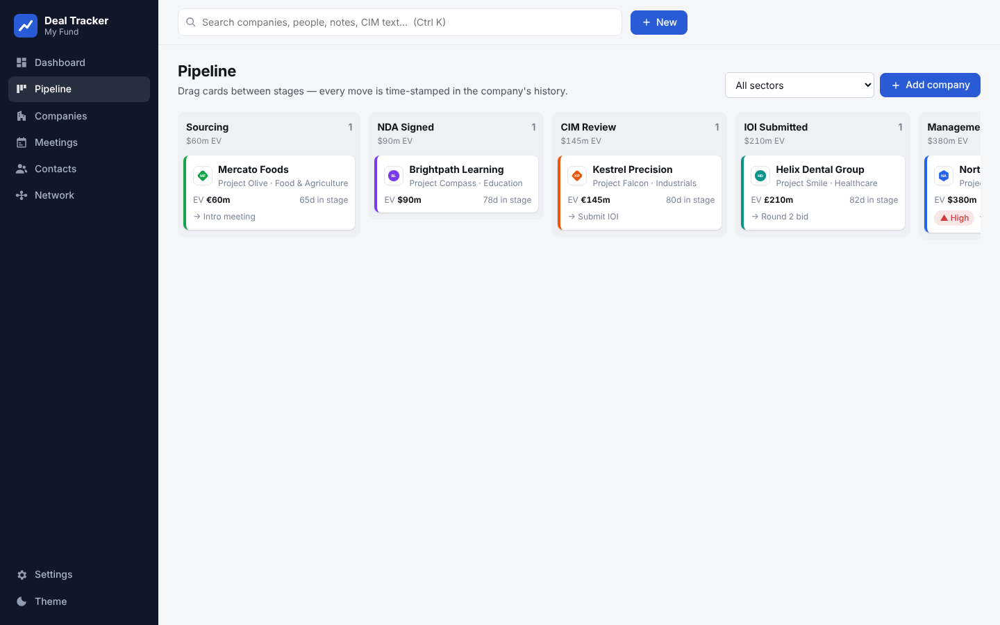
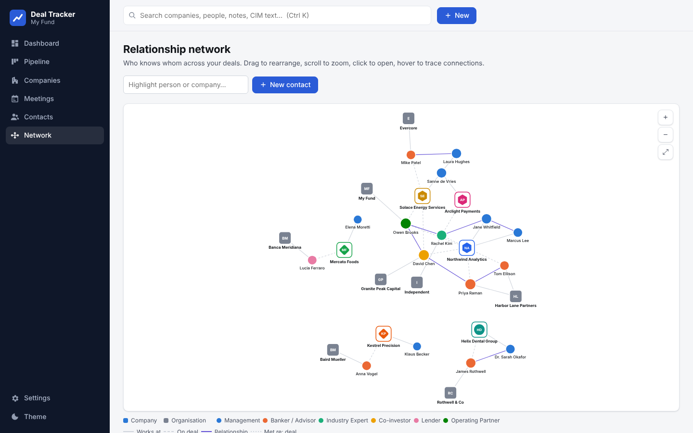

# Deal Tracker

A private, local deal-tracking app for private equity. It runs on your own computer. Your data, CIMs and models stay in a local folder unless you choose to use the optional Claude analysis.



## What it does

| Area | What you get |
|---|---|
| **Dashboard** | Live deals, pipeline EV, EBITDA and blended multiple, deals by stage, sector and region, 12-month activity, next steps (overdue ones flagged), upcoming meetings, a recent-activity feed and brand-coloured company cards. |
| **Companies** | Add a company in seconds with a logo, brand colour (it can pick the colour from the logo), sector, geography, stage, priority, deal type, EV, revenue, EBITDA, advisor and next step. Switch between card and table views, filter, sort and export to CSV. |
| **Pipeline** | A Kanban board. Drag a deal to another stage. Each move is time-stamped, and every company shows its stage history and days in stage. |
| **CIM fact detection** | Drop in a CIM (PDF, DOCX or TXT). The app detects revenue and EBITDA (from text and from financial tables), margins, CAGR, recurring revenue, retention, customers and concentration, headcount, HQ, founding year, CEO, ownership, sell-side advisor, transaction type, bid deadline, website, sector, geographies, investment highlights and risks. **Each fact shows the source sentence, page number and a confidence score.** You tick the facts to keep. You can also create a new company straight from a CIM. |
| **Claude analysis (optional)** | Add an Anthropic API key and click **Analyze with Claude** to have Claude read the whole document, including scanned PDFs. It adds facts with quotes, plus highlights, diligence questions and a summary. |
| **Models** | Upload LBO or operating models. Every upload becomes a new version (v1, v2…) with a timestamp. IRR, MOIC, entry and exit multiples, entry and exit EV, leverage, equity and hold period are read from the workbook and compared with the previous version. |
| **Meetings & market notes** | Log management presentations, banker calls, expert calls, site visits, IC meetings and general market meetings that aren't tied to a company. Each meeting has attendees, notes, takeaways, next steps and sentiment. All of it is searchable. |
| **Contacts & network diagram** | Track bankers, management, experts, co-investors and lenders, with relationship strength and meeting history. Map relationships such as "former colleague", "reports to" or "introduced". An interactive network diagram (drag, zoom, hover to trace connections) shows who connects to which deal. |
| **Everything else** | Global search (Ctrl/⌘ K) across companies, people, meeting notes and CIM text. A timeline for each company. Light and dark mode. Settings for stages, sectors, deal types and meeting types. JSON backup. |

| Company page | CIM fact review |
|---|---|
|  |  |
| **Pipeline** | **Relationship network** |
|  |  |

## Run it

You need **Python 3.9 or newer** ([python.org](https://www.python.org/downloads/)).

- **macOS:** double-click `Start Deal Tracker.command`, or run `./run.sh` in Terminal.
- **Windows:** double-click `run.bat`.
- **Linux:** `./run.sh`

The first launch installs its dependencies into a local `.venv` folder. After that it starts in a second or two and opens **http://127.0.0.1:5050** in your browser. On the empty dashboard, click **Load demo data** to explore a sample pipeline.

Options: `./run.sh --port 8080`, `./run.sh --data /path/to/folder`, `./run.sh --no-browser`.

### Try the CIM detection
`samples/` contains two sample CIMs (`Project_Cedar_CIM.pdf`, `Project_Atlas_CIM.txt`) and two versions of a sample LBO model. Use **New → Company from CIM** and drop in the PDF.

## Your data

Everything lives in the `data/` folder next to the app:
- `dealtracker.db` is a SQLite database with companies, meetings, contacts, settings and history.
- `uploads/` holds logos, CIMs, models and other documents.

To back up, copy that folder. **Settings → Download JSON backup** also exports everything except the files. The app only listens on `127.0.0.1`, so other computers on your network can't reach it. If you use `--host 0.0.0.0`, anyone on your network can open it, because there is no login.

### Claude (optional)
Set the `ANTHROPIC_API_KEY` environment variable, or paste a key in **Settings**. A key saved in Settings is stored in the local database. A document is sent to the Anthropic API only when you click **Analyze with Claude**. The rule-based detector works fully offline.

## Development

```bash
python3 -m venv .venv && .venv/bin/pip install -r requirements.txt pytest
.venv/bin/python -m pytest        # API, extractor and model-parser tests
.venv/bin/python run.py           # start the server
```

Stack: Flask + SQLite backend (`dealtracker/`). The frontend is plain HTML/CSS/ES modules with no build step (`static/`). Charts and the network diagram are hand-written SVG, so the app needs no CDN and works offline.

```
dealtracker/
  app.py            JSON API + static file serving
  db.py             schema, settings, activity log
  extractor.py      CIM text extraction + rule-based fact detection
  ai.py             optional Claude analysis (structured output)
  models_parser.py  reads IRR / MOIC / multiples from Excel models
  geo.py            country → region mapping
  seed.py           demo data
static/js/
  app.js            router, global search, quick-add
  forms.js          company / contact / meeting dialogs, CIM review
  graph.js          force-directed relationship diagram
  charts.js         bar & column charts
  views/*.js        dashboard, pipeline, companies, company, meetings, contacts, settings
```
